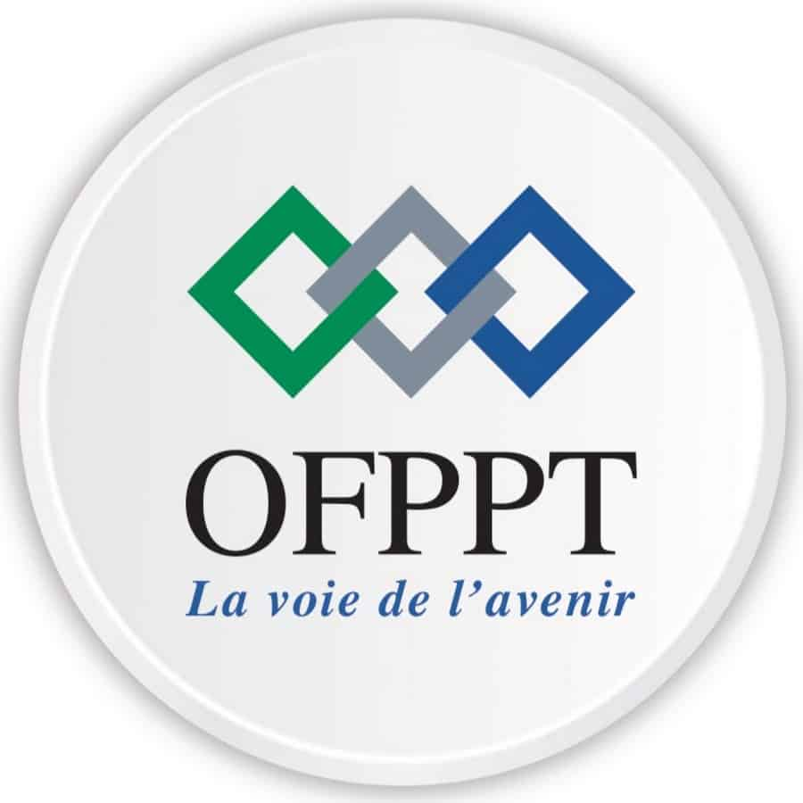
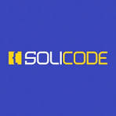

<!-- _class: cover -->

<!-- _class: cover -->

# LABS & TECHNICAL STACK

### Discovering Tools, Technologies and Methodologies

 

**Technical Project Presentation**

**Prepared by:** Mounir L Maimouni

**Supervised by:** E-sseraj Fouad

**Training Center:** Solicode Tanger

---

# Technical Project

## Destination Guide

Destination Guide is a web application designed to help users discover tourist destinations in Morocco.

### Main Objectives

- Discover different tourist destinations.
- Explore cultural, historical, and natural attractions.
- Access useful information about each destination.
- Allow the Tour Guide to manage destination information.

---

# Technical Stack

### Frontend
- JavaScript
- Alpine.js
- Tailwind CSS
- Preline

### Backend
- PHP
- Laravel

### Database
- MySQL

### Programming Language
- Kotlin

---

# Understanding Labs

### What is a Lab?

A Lab is a practical method that allows us to apply what we have learned in theory and improve our skills.

### Why Conduct Labs?

- Discover new tools and technologies.
- Test solutions through practical exercises.
- Develop technical and problem-solving skills.
- Gain experience before applying tools to real projects.

### Link with the Technical Project

Labs help us explore and test technologies and solutions that can be used to develop and improve our technical project.

---

# List of Labs

<!-- _class: labs -->

1. Qu’est-ce qu’un lab ?
2. Markdown
3. GitHub Pages
4. Antigravity
5. Marp
6. OpenCode
7. Pandoc
8. OmniRoute
9. 2Tup
10. Design Thinking

11. Scrum
12. OOP
13. Copilot
14. Laravel
15. Preline
16. Git
17. ASCII
18. PHP Native
19. Kotlin

20. ES7 JavaScript
21. Prompt-Agent-Skills
22. Communication avec IA
23. Starter
24. Planning
25. Stack
26. Veille technologique
27. Errors JS
28. Agent

