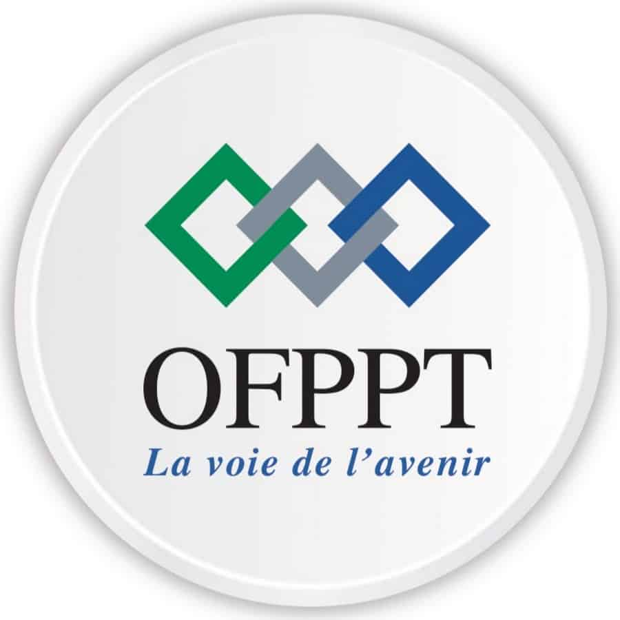
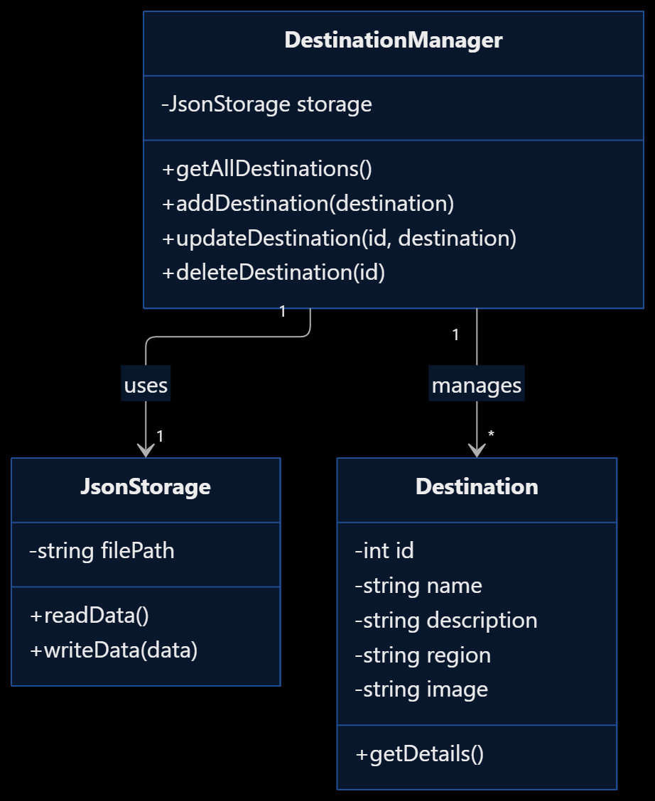
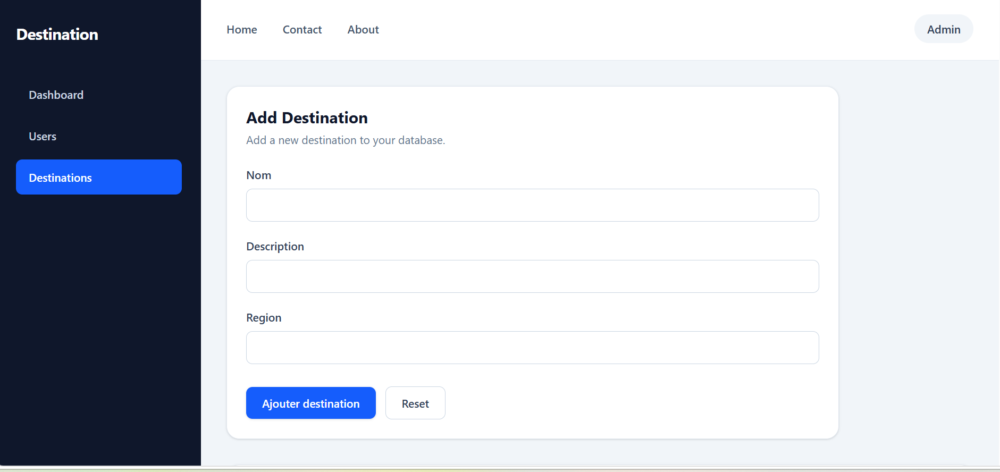
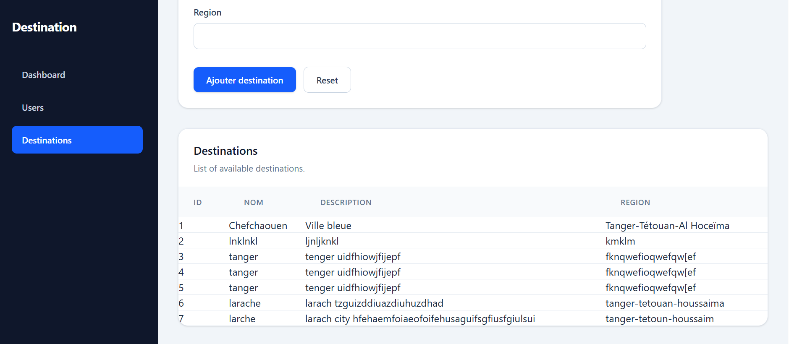

<!-- _class: cover -->

#  DESTINATION GUIDE

### Discover Morocco, One Destination at a Time.

 

**Technical Project Presentation**
**Prepared by:** Mounir L Maimouni
**Supervised by:** E-sseraj Fouad

---
# Introduction

Destination Guide is a web application designed to help visitors
discover the beauty of Morocco and explore its tourist destinations.

- Discover tourist destinations.
- Explore cultural, historical, and natural attractions.
- Access useful information about each destination.
- Manage destinations through a private dashboard. manage destination information easily.

---
# The Need – Problem Statement

Morocco has many beautiful tourist destinations, but visitors may struggle to find organized and reliable information about these places.

**Main Problems:**
- Tourist information is scattered across different sources.
- Visitors may have difficulty discovering new destinations.
- Finding useful details about destinations can take time.
- Managing destination information manually can be difficult for the Tour Guide.

**Our Solution:**

Destination Guide brings destination information together in one platform, making it easier for visitors to explore Morocco.

---

# Analysis – Requirements and Features

### Visitor
- Browse tourist destinations.
- View destination details.
- Explore Morocco without an account.

### Tour Guide
- Log in to the dashboard.
- Add new destinations.
- Edit destination information.
- Delete destinations.
- Manage profile information.

---

### Main Functionalities
- Public destination listing.
- Destination management (CRUD).
- Private dashboard.
- Authentication.

**Main Actors:** Visitor and Tour Guide.

---

# Conception – System Design

The conception phase defines the structure and organization of the Destination Guide application.

---

# 1. Use Case Diagram

---

# 2. Class Diagram

---
# Réalisation – Technical Implementation

### Technologies Used :
 

| frontend | backend |
|----------|---------|
|    HTML  |   PHP   |
| Tailwind |   JSON  |
| javascript |       |

 

- **HTML5:** Structures the web pages.
- **Tailwind CSS:** Provides responsive styling.
- **JavaScript:** Handles user interactions.
- **PHP:** Manages backend operations.
- **JSON:** Stores application data.

---
# Next step: Réalisation – Application Screenshots
 

---
 # Tour Guide Dashboard screenshot :
 
 ---
# Conclusion

Destination Guide is a web application that helps visitors
discover and explore tourist destinations in Morocco.

